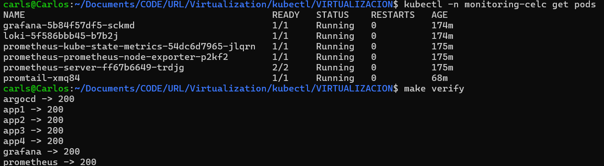
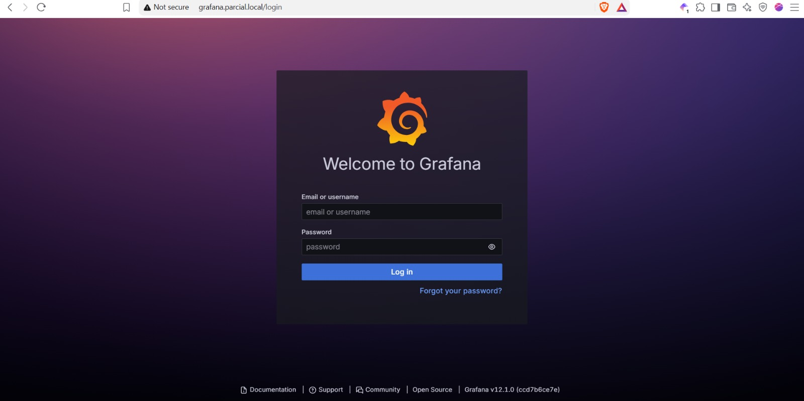
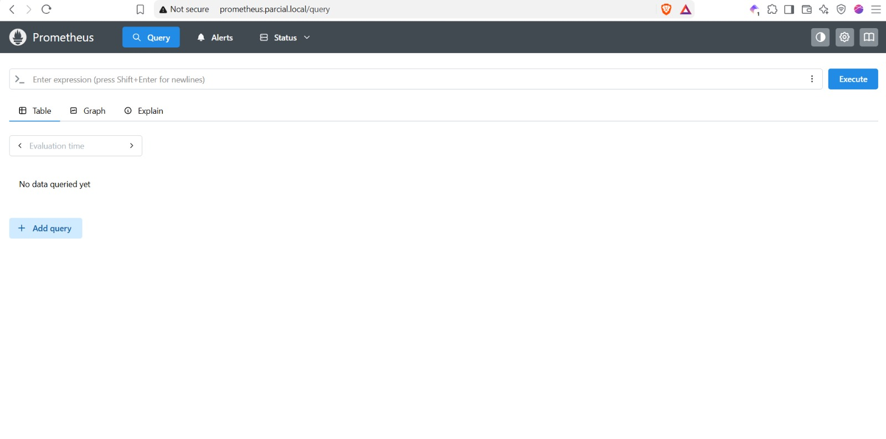
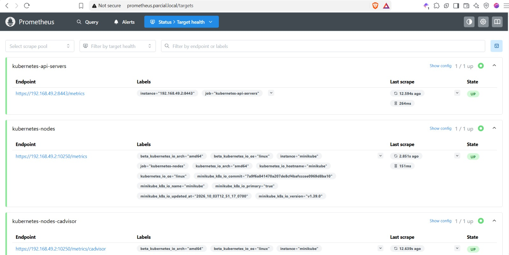
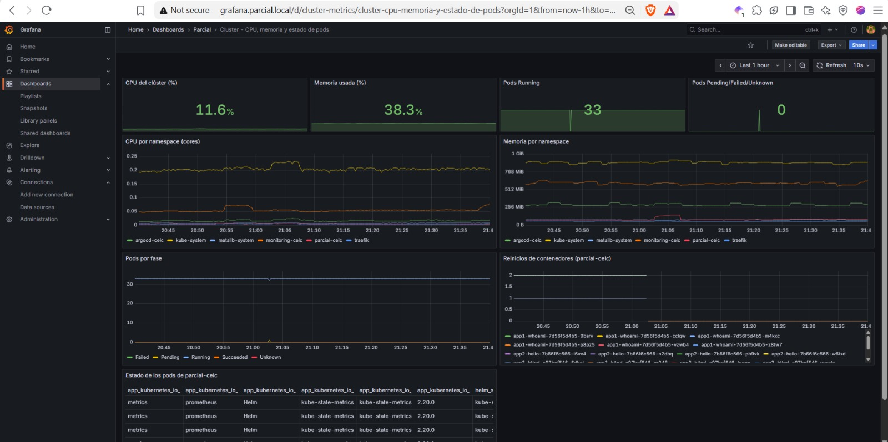
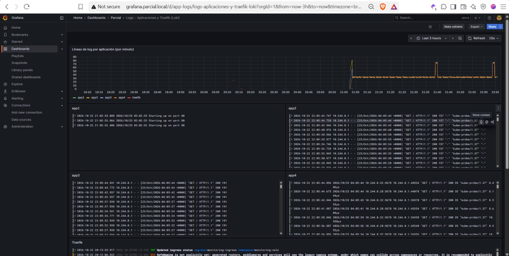
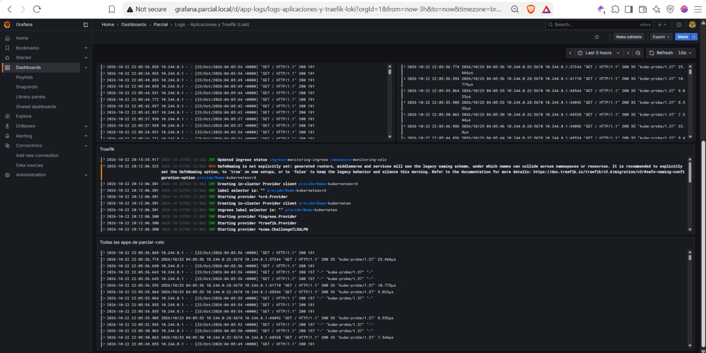

# Proyecto Personal 01: Monitoreo y logs con Prometheus, Loki, Promtail y Grafana

Stack de observabilidad dentro del clúster de Minikube (con MetalLB y Traefik de las entregas anteriores). **Prometheus** recolecta métricas del clúster, **Promtail** (DaemonSet) envía los logs de las 4 aplicaciones y de Traefik a **Loki**, y **Grafana** los muestra con data sources y dashboards provisionados como código. Grafana y Prometheus se exponen por Traefik con la IP de MetalLB.

- **Rama:** `personal-project-01`
- **Namespace del stack:** `monitoring-celc`
- **Dominios:** `grafana.parcial.local`, `prometheus.parcial.local`

## Arquitectura

```
Pods de parcial-celc y traefik ──logs──► Promtail (DaemonSet) ──► Loki ──┐
Nodo, kubelet, cAdvisor, kube-state-metrics ◄──scrape── Prometheus ──────┤
                                                                         ▼
Navegador ─► /etc/hosts ─► 192.168.49.240 (MetalLB) ─► Traefik ─► Grafana (Prometheus + Loki)
                                                              └─► Prometheus
```

## Estructura del IaC

```
.
├── Makefile                                  # regla observability
├── traefik/values.yaml                       # + access logs habilitados
├── scripts/hosts.sh                          # + grafana y prometheus
└── monitoring/
    ├── namespace.yaml
    ├── prometheus/values.yaml                # Helm values (prometheus-community)
    ├── loki/loki.yaml                        # ConfigMap + Deployment + Service
    ├── promtail/promtail.yaml                # RBAC + ConfigMap + DaemonSet
    ├── grafana/
    │   ├── grafana.yaml                      # provisioning de data sources + Deployment + Service
    │   └── dashboards/
    │       ├── cluster-metrics.json          # CPU, memoria y estado de pods
    │       └── app-logs.json                 # logs de las 4 apps y Traefik
    └── ingress.yaml                          # Grafana y Prometheus por Traefik
```

| Requisito | Dónde se cumple |
|---|---|
| Todo en un único namespace | `monitoring-celc` (`monitoring/namespace.yaml`) |
| Prometheus recolectando métricas del clúster | `monitoring/prometheus/values.yaml` |
| Loki como almacenamiento de logs | `monitoring/loki/loki.yaml` |
| Promtail como DaemonSet (apps + Traefik) | `monitoring/promtail/promtail.yaml` |
| Data sources como código | ConfigMap `grafana-datasources` en `monitoring/grafana/grafana.yaml` |
| Dashboards de métricas y logs | `monitoring/grafana/dashboards/*.json` |
| Exposición por Traefik y DNS | `monitoring/ingress.yaml` · `scripts/hosts.sh` |

## Despliegue

```bash
minikube start
make
```

La regla `observability` del Makefile instala el stack completo:

| Paso | Qué hace |
|---|---|
| 1 | Crea el namespace `monitoring-celc` |
| 2 | Instala Prometheus con Helm (`prometheus-community/prometheus`) y `monitoring/prometheus/values.yaml` |
| 3 | Aplica Loki y Promtail |
| 4 | Crea el Secret de Grafana y el ConfigMap con los dashboards JSON |
| 5 | Aplica Grafana (data sources provisionados) y el Ingress |

Después `make hosts` agrega `grafana.parcial.local` y `prometheus.parcial.local` a `/etc/hosts` apuntando a `192.168.49.240`, y `make verify` comprueba que respondan.

## Configuración

**Prometheus.** Chart oficial de `prometheus-community` con Alertmanager y Pushgateway desactivados. Incluye `kube-state-metrics` (estado de pods) y `node-exporter` (CPU y memoria del nodo), y sus scrape configs por defecto recolectan kubelet, cAdvisor, el API server y los endpoints anotados. Sin volumen persistente y con retención de 6 horas, por ser un entorno local.

**Loki.** Un único Deployment en modo monolítico con almacenamiento en filesystem (TSDB, esquema v13) y retención de 24 horas. Se despliega con manifiestos propios porque el chart de Loki cambió de repositorio y de numeración en 2026. Los datos están en un `emptyDir`: se pierden si el pod se reinicia, lo cual es aceptable en este entorno.

**Promtail.** DaemonSet que lee `/var/log/pods` del nodo (hostPath de solo lectura) y envía los logs a Loki. Cada aplicación (`app1` a `app4`) y Traefik tiene su propia ruta explícita en `static_configs`, con las etiquetas `namespace` y `app`, que se usan en los dashboards (por ejemplo `app="app1"`). El runtime del nodo es containerd, por lo que el pipeline usa el parser `cri`. Los access logs de Traefik se habilitan en `traefik/values.yaml` (`logs.access.enabled: true`).

> Promtail fue declarado fin de vida (EOL) en marzo de 2026 y reemplazado por Grafana Alloy. Se usa por requerimiento de la actividad, con la imagen `grafana/promtail:3.6.0` fijada.

**Grafana.** Todo se provisiona al arrancar, sin pasos manuales en la interfaz:

- *Data sources* (`grafana-datasources`): `Prometheus` (por defecto) y `Loki`, con UID fijo.
- *Dashboards* (`grafana-dashboards`): los JSON de `monitoring/grafana/dashboards/`, cargados en la carpeta **Parcial**.
- Usuario `admin`; la contraseña se define al desplegar (variable `GRAFANA_PASSWORD` del Makefile) y se guarda en un Secret, no en Git.

**Dashboards.**

| Dashboard | Paneles |
|---|---|
| Cluster - CPU, memoria y estado de pods | CPU y memoria del clúster, pods Running y con problemas, CPU y memoria por namespace, pods por fase, tabla de estado de `parcial-celc`, reinicios |
| Logs - Aplicaciones y Traefik (Loki) | Líneas de log por app, un panel de logs por cada app (`app1` a `app4`), Traefik y todas las apps juntas |

**Exposición.** `monitoring/ingress.yaml` define un Ingress con `ingressClassName: traefik` y dos hosts: `grafana.parcial.local` hacia el Service `grafana` y `prometheus.parcial.local` hacia `prometheus-server`. Ambos se resuelven a la IP de MetalLB mediante `/etc/hosts`.

## Verificación

```bash
kubectl -n monitoring-celc get pods
make verify
```

Para generar logs de las aplicaciones y de Traefik:

```bash
for i in $(seq 1 30); do for n in 1 2 3 4; do curl -s -o /dev/null http://app$n.parcial.local; done; done
```



### Grafana y Prometheus por nombre de dominio





### Prometheus: Targets en estado UP



### Dashboard de métricas



### Dashboard de logs (4 aplicaciones)




## Acceso desde Windows (opcional)

Con `make bridge`, el hosts de Windows apunta los dominios (incluidos `grafana.parcial.local` y `prometheus.parcial.local`) a `127.0.0.1`. Solo sirve para visualizar; lo evaluado es `/etc/hosts` en WSL.

## Limpieza

```bash
kubectl delete -f monitoring/ingress.yaml -f monitoring/grafana/grafana.yaml -f monitoring/promtail/promtail.yaml -f monitoring/loki/loki.yaml
helm uninstall prometheus -n monitoring-celc
kubectl delete namespace monitoring-celc
```