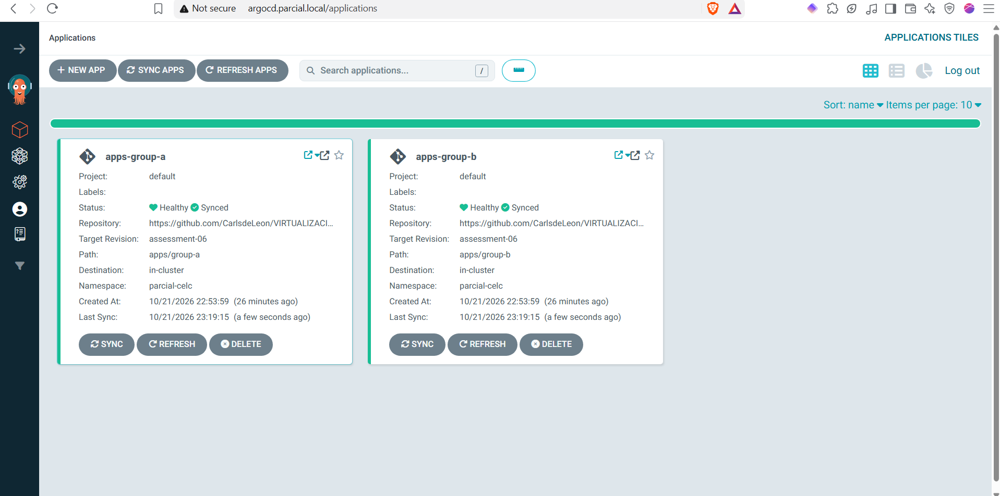
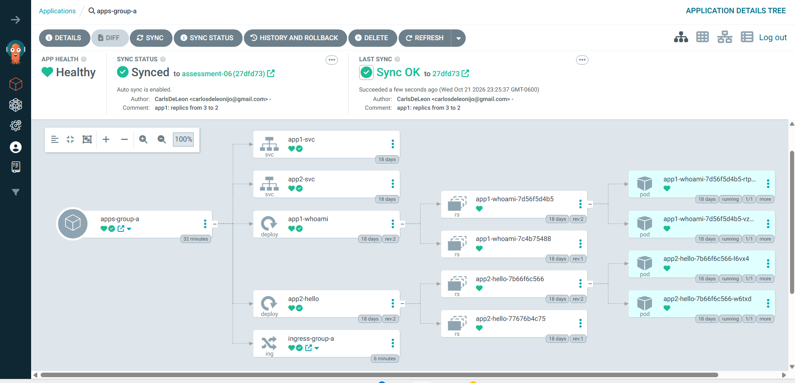
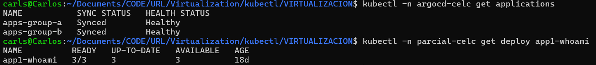
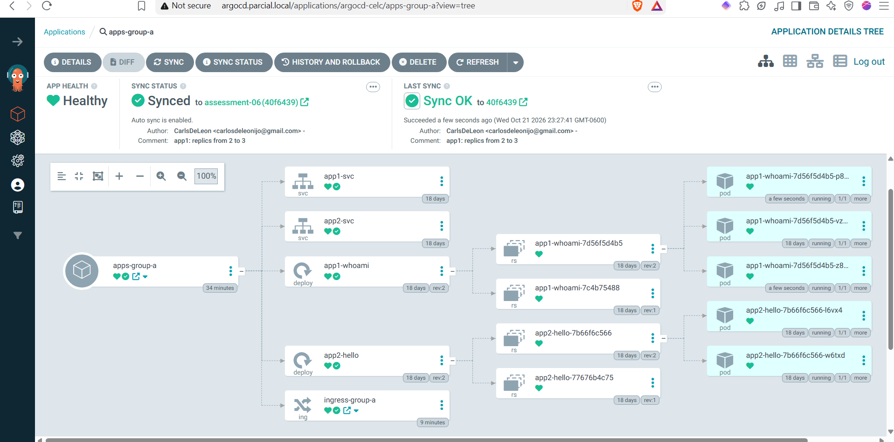

# Evaluación Parcial: Argo CD y GitOps

Instalación de **Argo CD** en Minikube, expuesto mediante **Traefik** con un nombre de dominio, y despliegue de las 4 aplicaciones del namespace `parcial-celc` desde este repositorio siguiendo el enfoque **GitOps**. Toda la configuración está definida como código (YAML, values de Helm y Makefile).

- **Rama:** `assessment-06`
- **Namespace de Argo CD:** `argocd-celc`
- **Namespace de las apps:** `parcial-celc`
- **Dominios:** `argocd.parcial.local`, `app1.parcial.local` ... `app4.parcial.local`

## Arquitectura

```
GitHub (rama assessment-06)
        │  Argo CD sincroniza (apps/group-a, apps/group-b)
        ▼
Argo CD (ns: argocd-celc) ───────► Clúster: ns parcial-celc (4 apps)

Navegador ─► /etc/hosts ─► 192.168.49.240 (MetalLB) ─► Traefik ─► Ingress ─► Service ─► Pod
                                                          ├── argocd.parcial.local ─► argocd-server
                                                          └── appN.parcial.local   ─► appN-svc
```

## Estructura del IaC

```
.
├── Makefile                          # punto de entrada del despliegue
├── metallb/metallb-config.yaml       # pool de una sola IP
├── traefik/values.yaml               # Service LoadBalancer
├── argocd/
│   ├── values.yaml                   # Helm values de Argo CD
│   ├── ingress.yaml                  # exposición por Traefik
│   └── applications/
│       ├── apps-group-a.yaml         # Application: app1 y app2
│       └── apps-group-b.yaml         # Application: app3 y app4
├── apps/
│   ├── group-a/                      # Deployments, Services e Ingress de app1 y app2
│   └── group-b/                      # Deployments, Services e Ingress de app3 y app4
├── scripts/hosts.sh                  # DNS local en /etc/hosts
├── bridge/docker-compose.yaml        # opcional: acceso desde Windows
└── screenshots/
```

| Requisito | Dónde se cumple |
|---|---|
| Argo CD en el namespace `argocd-celc` | `make argocd` · `argocd/values.yaml` |
| Argo CD expuesto por Traefik con dominio | `argocd/ingress.yaml` · `scripts/hosts.sh` |
| Conexión al repositorio y a la rama | `repoURL` y `targetRevision: assessment-06` en `argocd/applications/` |
| Al menos dos Application | `apps-group-a.yaml` y `apps-group-b.yaml` |
| Cambio en el repo sincronizado | Sección "Cambio en el repositorio" |

## Despliegue

Los manifiestos deben estar en GitHub antes de crear las Application, porque Argo CD los lee desde el repositorio.

```bash
git push -u origin assessment-06
minikube start
make
```

| Regla | Qué hace |
|---|---|
| `metallb` | Instala MetalLB y aplica el pool de una sola IP |
| `traefik` | Instala Traefik con Helm (Service `LoadBalancer`) |
| `route` | Ruta local hacia la IP de MetalLB (ver nota WSL) |
| `argocd` | Instala Argo CD con Helm y aplica su Ingress |
| `gitops` | Aplica las Application; Argo CD despliega las apps |
| `hosts` | Agrega los dominios a `/etc/hosts` |
| `verify` | Comprueba que cada dominio responda `200` |

## Configuración

**Argo CD.** Se instala con el chart oficial de Helm en el namespace `argocd-celc`. `server.insecure: true` en `argocd/values.yaml` hace que `argocd-server` hable HTTP, ya que Traefik termina el tráfico en HTTP y, sin esto, Argo CD redirigiría a HTTPS en bucle.

**Exposición.** `argocd/ingress.yaml` define un Ingress con `ingressClassName: traefik` y el host `argocd.parcial.local`, que apunta al Service `argocd-server`. `/etc/hosts` resuelve ese dominio a `192.168.49.240`, la IP del LoadBalancer de Traefik asignada por MetalLB.

**Application.** Hay dos, ambas con sincronización automática (`prune` y `selfHeal`) y `CreateNamespace=true`:

| Application | Ruta en el repo | Contenido |
|---|---|---|
| `apps-group-a` | `apps/group-a` | app1 (`whoami`), app2 (`hello`) |
| `apps-group-b` | `apps/group-b` | app3 (`httpd`), app4 (`http-echo`) |

Ambas despliegan en el namespace `parcial-celc` del clúster local.

**Acceso.** Usuario `admin`. La contraseña inicial se obtiene con:

```bash
kubectl -n argocd-celc get secret argocd-initial-admin-secret -o jsonpath='{.data.password}' | base64 -d; echo
```

**Nota WSL2.** Desde WSL no se recibía respuesta ARP de MetalLB, por lo que la regla `route` agrega una ruta hacia la IP del LoadBalancer a través del nodo de Minikube. Se pierde al reiniciar WSL; basta con ejecutar `make route`.

## Verificación

```bash
kubectl -n argocd-celc get pods
kubectl -n argocd-celc get applications
kubectl -n parcial-celc get deploy,svc,ingress
make verify
```

```
(pegar aquí la salida: Applications en Synced/Healthy y verify con 200)
```

### Argo CD por nombre de dominio



### Application antes del cambio (Synced y Healthy)



## Cambio en el repositorio

Para comprobar el flujo GitOps se modificó el número de réplicas de `app1-whoami` en `apps/group-a/apps.yaml`, de `2` a `3`:

```bash
git add apps/group-a/apps.yaml
git commit -m "app1: replicas de 2 a 3"
git push
```

Argo CD detectó el cambio en el repositorio (con **Refresh** o en su siguiente revisión) y lo sincronizó automáticamente, sin ejecutar `kubectl apply`.

```

```

### Application después del cambio (Synced y Healthy)



## Acceso desde Windows (opcional)

Windows no ve la red de Minikube. `make bridge` levanta un contenedor `socat` que reenvía `localhost:80` a la IP de MetalLB, y el archivo hosts de Windows apunta los dominios (incluido `argocd.parcial.local`) a `127.0.0.1`. El tráfico sigue pasando por MetalLB y Traefik. Solo sirve para visualizar; lo evaluado es `/etc/hosts` en WSL.

## Limpieza

```bash
make clean
sudo sed -i '/parcial\.local/d' /etc/hosts
```